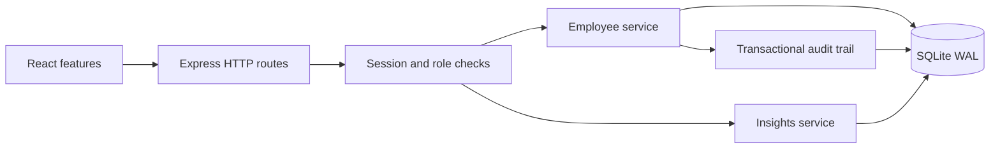

# Architecture and decisions

The application has a same-origin Node.js/Express API, a React client and a SQLite-compatible relational database. The official libSQL client supports local SQLite and remote Turso/libSQL for Vercel hosting. This keeps setup and deployment understandable while satisfying the assessment's full-stack and relational-storage constraints.

## Module boundaries

`src/features` contains login, overview, directory/forms and activity modules. Reusable layout/form components are in `src/components.tsx`; typed HTTP helpers and formatting live in `src/api.ts`. The API separates transport (`app.ts`), authentication (`auth.ts`), database schema (`db.ts`), employee operations (`employees.ts`), analytics (`insights.ts`) and pure validation/statistics (`domain.ts`). UI request effects ignore stale responses. Forms use native validation plus the server's Zod schemas.

## Compensation semantics

Salary means annual gross base pay. Decimal input is converted from text to integer minor units, avoiding floating-point storage errors. Employee country determines currency for the supported six-country scope. Local analytics are scoped to exactly one currency; the optional USD view applies clearly labeled illustrative static rates and rounds each employee to USD cents. There is no misleading organization-wide mixed-currency budget. Quantiles use linear interpolation over sorted data. Peer outliers use the Tukey 1.5×IQR rule within country, job title and employment type, only for groups of five or more and nonzero IQR. They are review signals rather than explanations of fairness.

## Security and correctness

Passwords use random salts and Node's scrypt. Opaque 256-bit session tokens are sent only through HttpOnly, SameSite=Strict cookies; the database stores their SHA-256 hashes with eight-hour expiry. Production cookies require HTTPS. Logout deletes the session. Demo registration defaults to Viewer and permits an explicit HR role only because this public assessment contains synthetic data. Real deployments must require invitations/administrator approval. Authorization is applied before writes and audit access; viewer serializers omit salary fields at the API boundary. Viewer salary sorts are also denied. Exact min/max and outlier employee records are unavailable to viewers. Small-group suppression is not a formal differential-privacy guarantee.

All writes require a custom request header; cross-origin browser requests cannot send it without CORS permission, which this application does not grant. JSON bodies are size-limited and validated. SQL values use bound parameters and sort columns come from a fixed whitelist. CSV cells are quoted and potential formulas prefixed. Request IDs accompany responses and unexpected-error logs omit request bodies and credentials. All API requests are rate-limited by IP, with stricter login and registration limits. Exact same-origin checks reject cross-origin requests.

Employee edits and deletes require the version last read by the user. A stale request returns 409. Mutation and audit entry commit together in an immediate transaction, so neither silently succeeds alone. Duplicate email constraints return a readable 409 error. The seed refuses to destroy existing data.

## Storage and performance

SQLite WAL allows readers during writes, with a five-second busy timeout. Indexes support country, department, currency/salary and name/ID access. Directory endpoints return at most 100 records; the UI requests 20. Text substring searches are parameterized and scan at this size; a measured need would justify FTS. Exports stream into a response-sized in-memory string at the 10,000-row scope. Analytics load the filtered records (all currencies for approximate USD) and sort for exact quantiles. A larger deployment should use indexed PostgreSQL queries/materialized summaries, a CSV stream and background analytics.

The asynchronous database adapter returns promises and scopes each mutation to an explicit transaction object. Local SQLite needs a single server with persistent disk. Vercel uses durable remote libSQL and reuses connections within warm instances. Scrypt remains synchronous; the in-memory login limiter is per instance and must be replaced by a shared limiter for stronger production protection. Session and audit retention cleanup should be scheduled for long-running production use. Committed ordered SQL migrations in `server/migrations` are transactionally applied and tracked in `schema_migrations` (versions 1 and 2). Indexes also support job-title and joining-date filtering.

## Extended reports and observability

Tenure uses completed calendar anniversaries as of the explicit fixed assessment date 2026-10-14, grouped into under 1, 1–2, 3–4, 5–9 and 10+ years. Viewer tenure groups below five are suppressed and extremes omitted. Reports are descriptive, not causal.

Structured logging accepts only method, route template, request ID, status and duration; credentials, headers, request bodies and query strings cannot enter the logger. Console and database levels are configurable and validated. Database writes are asynchronous and protected with Vercel `waitUntil`; failures fall back to the retained console record. HR can inspect the latest 100 stored events. Audit request IDs commit in the same transaction as the employee mutation. Logs currently require an operational retention policy; default DB level is warn to keep the free tier economical.

Swagger UI assets are self-hosted (Apache-2.0 license included), with read-only Try-it-out methods. All API documentation requires a valid cookie session. Sessions+scrypt and SQLite/Turso remain deliberate alternatives to the reference's JWT+bcrypt and PostgreSQL/Prisma; equivalent engineering goals do not require identical dependencies or a monorepo.
