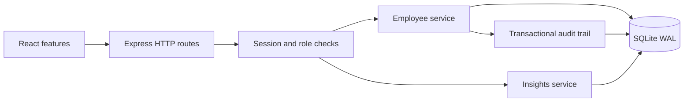

# Architecture and decisions

The application has one same-origin Node.js/Express server, a React client and a SQLite database. This keeps setup and deployment understandable while satisfying the assessment's full-stack and relational-storage constraints.

## Module boundaries

`src/features` contains login, overview, directory/forms and activity modules. Reusable layout/form components are in `src/components.tsx`; typed HTTP helpers and formatting live in `src/api.ts`. The API separates transport (`app.ts`), authentication (`auth.ts`), database schema (`db.ts`), employee operations (`employees.ts`), analytics (`insights.ts`) and pure validation/statistics (`domain.ts`). UI request effects ignore stale responses. Forms use native validation plus the server's Zod schemas.

## Compensation semantics

Salary means annual gross base pay. Decimal input is converted from text to integer minor units, avoiding floating-point storage errors. Employee country determines currency for the supported six-country scope. Analytics are scoped to exactly one currency; there is no misleading organization-wide mixed-currency budget. Quantiles use linear interpolation over sorted data. Peer outliers use the Tukey 1.5×IQR rule within country, job title and employment type, only for groups of five or more and nonzero IQR. They are review signals rather than explanations of fairness.

## Security and correctness

Passwords use random salts and Node's scrypt. Opaque 256-bit session tokens are sent only through HttpOnly, SameSite=Strict cookies; the database stores their SHA-256 hashes with eight-hour expiry. Production cookies require HTTPS. Logout deletes the session. No roles are chosen by the client or by self-registration. Authorization is applied before writes and audit access; viewer serializers omit salary fields at the API boundary. Viewer salary sorts are also denied. Exact min/max and outlier employee records are unavailable to viewers. Small-group suppression is not a formal differential-privacy guarantee.

All writes require a custom request header; cross-origin browser requests cannot send it without CORS permission, which this application does not grant. JSON bodies are size-limited and validated. SQL values use bound parameters and sort columns come from a fixed whitelist. CSV cells are quoted and potential formulas prefixed. Request IDs accompany responses and unexpected-error logs omit request bodies and credentials. Login is rate-limited by IP.

Employee edits and deletes require the version last read by the user. A stale request returns 409. Mutation and audit entry commit together in an immediate transaction, so neither silently succeeds alone. Duplicate email constraints return a readable 409 error. The seed refuses to destroy existing data.

## Storage and performance

SQLite WAL allows readers during writes, with a five-second busy timeout. Indexes support country, department, currency/salary and name/ID access. Directory endpoints return at most 100 records; the UI requests 20. Text substring searches are parameterized and scan at this size; a measured need would justify FTS. Exports stream into a response-sized in-memory string at the 10,000-row scope. Analytics load one currency's records and sort for exact quantiles. A larger deployment should use indexed PostgreSQL queries/materialized summaries, a CSV stream and background analytics.

The single-process synchronous SQLite model favors low operational complexity. It blocks the event loop during a query or scrypt operation and requires a single replica with persistent storage. Horizontal scaling requires a different storage/rate-limit architecture. Session and audit retention cleanup should be scheduled for long-running production use. Schema version 1 is tracked in `schema_migrations`; future structural changes require explicit ordered migrations.
